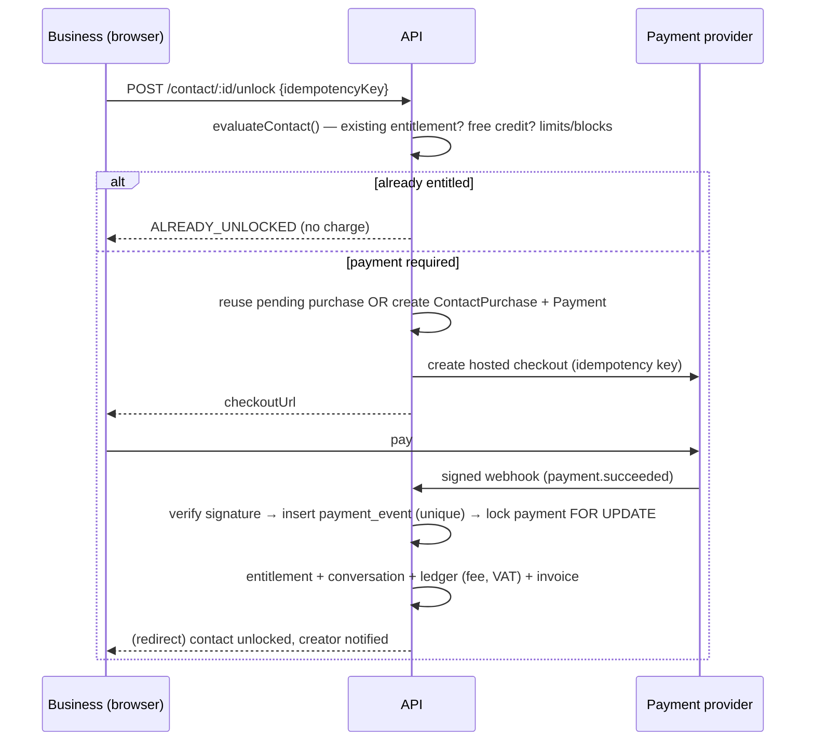
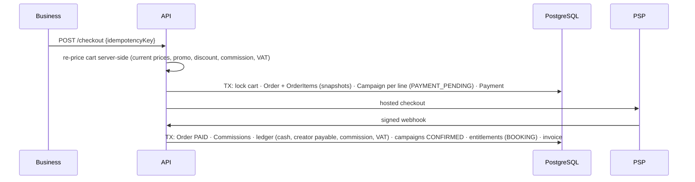
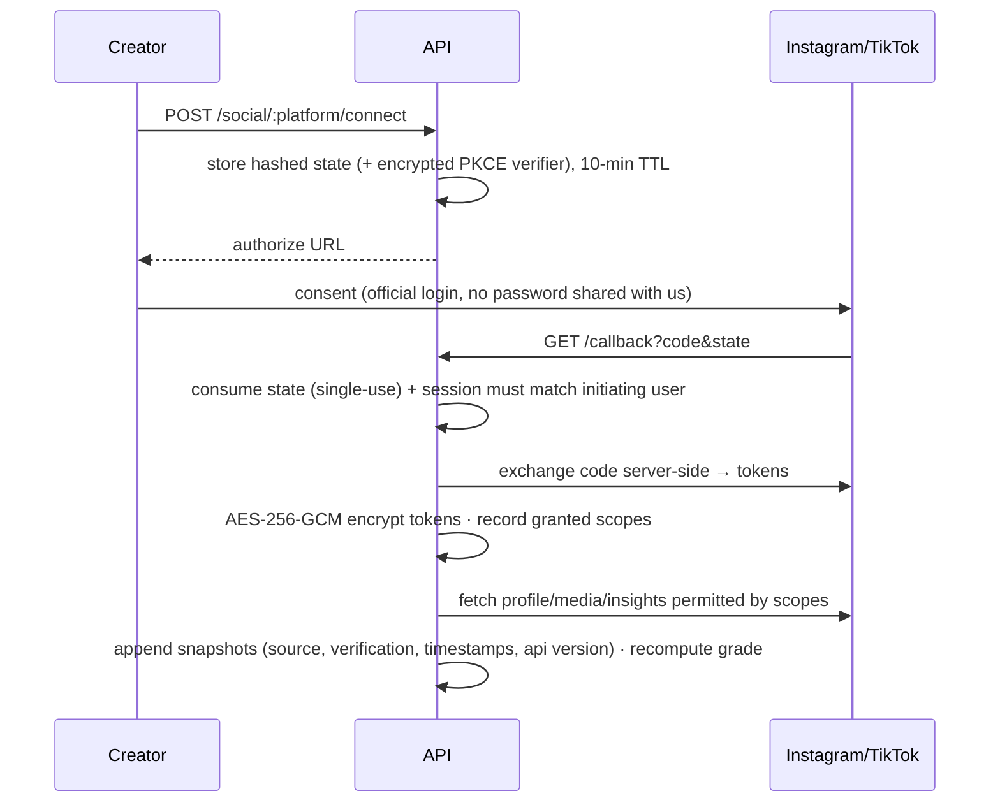

# InfluenceHub — Architecture

> UAE-first influencer marketing marketplace. English + Arabic (RTL). AED. Commercial, secure, auditable.

## 1. System overview

```mermaid
flowchart LR
  subgraph Browser
    W[Next.js 15 web app<br/>EN/AR · RTL · SSR + React Query]
  end
  subgraph Edge
    CDN[CDN / TLS termination]
  end
  subgraph App["Application tier (stateless, horizontally scalable)"]
    WEB[apps/web<br/>Next.js server<br/>/api/v1 same-origin proxy]
    API[apps/api<br/>NestJS REST API<br/>OpenAPI /api/docs]
    WK[apps/worker<br/>BullMQ workers + schedulers]
  end
  subgraph Data
    PG[(PostgreSQL 16<br/>Prisma · RLS · immutable ledger)]
    RD[(Redis<br/>queues · rate-limit store)]
    S3[(S3-compatible object storage<br/>private uploads)]
  end
  subgraph External["External providers (adapters)"]
    IG[Instagram API<br/>with Instagram Login]
    TT[TikTok Login Kit<br/>+ Display API]
    GG[Google OAuth / OIDC]
    PAY[Payment provider<br/>Stripe · sandbox · (Checkout.com/Telr/N-Genius planned)]
    LLM[LLM provider<br/>Anthropic Claude (optional)]
    MAIL[SMTP / SMS]
  end
  W --> CDN --> WEB -->|/api/v1 rewrite| API
  API --> PG & RD & S3
  WK --> PG & RD
  API --> IG & TT & GG & PAY & LLM & MAIL
  WK --> IG & TT & MAIL
  PAY -->|signed webhooks| API
```

### Why this shape
* **Modular monorepo (pnpm workspaces)** — `apps/web`, `apps/api`, `apps/worker`, `packages/database`, `packages/shared`, `packages/localization`, `packages/ui`, `packages/config`.
* **All business rules server-side.** The web app renders and calls the API; pricing, commission, VAT, entitlements, grading, campaign state transitions and authorisation execute in the API.
* **Pure domain core** (`packages/shared`): money (integer fils), VAT, commission, grading engine, pricing engine, entitlement rules, campaign state machine, RBAC map, search schema, NL query parser. Fully unit-tested, shared by API and web (for display only).
* **Same-origin cookies.** The browser only talks to the web origin; Next.js rewrites `/api/v1/*` to the API, so session cookies are first-party, `SameSite=Lax`, `HttpOnly`, `Secure` (prod).
* **Adapters for every external dependency** — Instagram, TikTok, sandbox social, Stripe, sandbox payments, Anthropic LLM, SMTP, SMS, S3/local storage. Sandbox adapters are clearly labelled, persist `source = SANDBOX`, and are hard-disabled when `APP_ENV=production`.

## 2. Technology stack (confirmed)

| Layer | Choice |
|---|---|
| Web | Next.js 15 App Router, React 19, TypeScript, Tailwind CSS 3 (design tokens), shadcn-style components, Lucide icons, React Hook Form + Zod, TanStack Query, next-intl |
| API | NestJS 11, REST, OpenAPI/Swagger (`/api/docs` non-prod), Zod validation pipes, `@nestjs/throttler`, Helmet |
| Auth | Custom, Auth.js-equivalent: argon2id passwords, JWT access cookie (15 min) + rotating opaque refresh token (hashed in `sessions`), CSRF double-submit, Google OIDC + PKCE, Instagram/TikTok OAuth, TOTP 2FA for admins |
| Data | PostgreSQL 16, Prisma 6 (migrations), raw SQL migration for CHECK constraints, triggers, RLS, trigram indexes |
| Jobs | BullMQ on Redis (social sync, grading, maintenance schedulers) |
| Storage | S3-compatible (SSE) or local disk (dev); magic-byte validation |
| AI | Provider-independent `QueryUnderstandingProvider`; Anthropic adapter (official SDK, structured outputs) + deterministic EN/AR rules parser |
| Tests | Vitest (domain), Jest + Supertest (API integration/security), Playwright (E2E) |
| Infra | Docker images per app, docker-compose for local, GitHub Actions CI |

## 3. Repository structure

```
/influencehub (repo root)
  apps/
    web/        Next.js app — public site, business portal, creator studio, admin
    api/        NestJS API — all domain modules; also exports WorkerModule
    worker/     Thin bootstrap that runs the API's WorkerModule (BullMQ workers + cron)
  packages/
    database/   Prisma schema, migrations, seed (RBAC, categories, catalogue, sample benchmarks, demo data)
    shared/     Pure domain logic + Zod schemas (unit tested)
    localization/ en.json / ar.json (1,000+ keys, parity-checked)
    ui/         Design tokens (re-exported by the web Tailwind config)
    config/     Shared tsconfig / lint presets
  infrastructure/  Dockerfiles, nginx sample, backup scripts
  documentation/   This folder
  scripts/         Dev helpers
  docker-compose.yml  .env.example  README.md
```

## 4. API module map (`apps/api/src/modules`)

| Module | Responsibility |
|---|---|
| auth | Registration (business/creator), login + lockout, sessions & refresh rotation with reuse detection, email/phone verification, password reset, Google OIDC, admin TOTP |
| social | Instagram/TikTok/sandbox adapters, OAuth state+PKCE, encrypted token storage, sync, append-only snapshots, disconnect/revoke, manual metrics |
| grading | Builds verified-weighted inputs from snapshots and computes/persists explainable scores + history |
| influencers | Public search (parameterised filters, sorting, pagination), public profile (visibility toggles), creator self-service, availability, medical credentials |
| businesses | Business profile, onboarding preferences, verification requests, dashboard |
| services | Service catalogue, rate cards, packages, pricing suggestions (benchmarks + formula) |
| contact | Paid-contact entitlement evaluation, free allowance, purchase + checkout |
| commerce | Cart, server-side pricing (commission/VAT/discounts), idempotent checkout, orders, invoices, fulfilment |
| payments | Provider abstraction, hosted checkout, webhook verification + idempotent processing, sandbox gateway |
| finance | Double-entry ledger, refunds (with proportional reversals), payouts, ledger-derived reports, reconciliation |
| quotations | Request/submit/accept/reject custom quotations (requires contact entitlement) |
| campaigns | 16-state lifecycle FSM, deliverables, approvals, revisions, publication evidence, reviews, disputes, auto-complete |
| messaging | Conversations with RLS context, entitlement enforcement, rate limit, contact-detail filtering, attachments, block/report |
| uploads | Content-validated uploads, private storage, authorised downloads |
| ai | NL → filters (LLM or rules), DB retrieval with progressive relaxation, explainable ranking, feedback, logs |
| notifications | In-app notifications, bilingual email outbox, optional SMS |
| privacy | Consent records, export, deletion (anonymisation preserving financial history) |
| admin | Dashboard, users/RBAC, verification queue, categories, catalogue, benchmarks, grading versions, fees/commission/VAT, bookings, compliance, payments, refunds, payouts, disputes, moderation, AI quality, audit logs, integrations, data requests |

## 5. Key flows

### 5.1 Paid contact


### 5.2 Booking checkout


### 5.3 Social connection


## 6. Security architecture (summary — see SECURITY.md)
* Identity: argon2id, lockout after 5 failures, constant-time responses, refresh-token rotation with reuse detection (revokes all sessions), admin TOTP mandatory before any admin API.
* Authorisation: global guard → user-type + permission checks (least-privilege admin roles) → resource ownership checks in services (404 on foreign resources) → PostgreSQL RLS for conversations/messages/notifications/tokens.
* Web: CSRF double-submit for cookie-authenticated mutations, Helmet/CSP, `X-Frame-Options: DENY`, strict CORS.
* Data: tokens & TOTP secrets encrypted at rest (AES-256-GCM, versioned envelope), financial ledger and audit log immutable via triggers, ledger balance enforced by deferred constraint trigger.
* Payments: signature verification on raw bodies, timestamp tolerance, unique provider event ids, `SELECT … FOR UPDATE`, amount/currency verification, idempotency keys end-to-end.

## 7. GCC extensibility
`Country` enum (AE, SA, QA, BH, KW, OM) and `country` columns exist; only AE is enabled (`platform.enabledCountries`). Currency is stored per row. Emirate is nullable to allow non-UAE regions later. Localisation already supports Arabic.

## 8. Scalability notes
Stateless API/web pods; Redis-backed queues; read-heavy search uses denormalised columns on `influencer_profiles` (grade, followers, views, engagement, starting price) with B-tree + GIN trigram indexes; public pages ISR-cached (60s); metrics are append-only and indexed by `(account, metric, collectedAt desc)`.
