# InfluenceHub — Database

PostgreSQL 16 · Prisma 6 · schema at `packages/database/prisma/schema.prisma` · migrations in `packages/database/prisma/migrations`.

## Conventions
* UUID primary keys; `timestamptz` (UTC); snake_case table names (`@@map`).
* Money: `numeric(14,2)` + `currency` (AED). Application arithmetic uses integer fils (`packages/shared/src/money.ts`).
* Soft deletion (`deletedAt`) for users/profiles/services; **financial rows are never deleted** (FK `Restrict`).
* History is append-only: `social_metric_snapshots`, `influencer_score_history`, `pricing_history`, `campaign_events`, `financial_ledger`, `audit_logs`, `payment_events`.

## Migrations
| Migration | Content |
|---|---|
| `…_init` | All tables, enums, FKs, unique constraints and indexes generated from the Prisma schema |
| `…_hardening` | CHECK constraints (ratings 1–5, positive amounts, promo < price, refund bounds, benchmark ordering, single-purpose payments, single-target cart items), partial unique indexes (one active cart, one live entitlement, one current score), **immutable ledger & audit log triggers**, **deferred ledger-balance constraint trigger**, `pg_trgm` GIN indexes for EN/AR search, **Row Level Security** policies |
| `…_sequences` | Sequences for human-readable numbers (`ORD-`, `INV-`, `CMP-`, `QT-`) |

Apply: `pnpm db:migrate` (uses `prisma migrate deploy`). For schema changes in development use `pnpm db:migrate:dev`; hand-written SQL lives in its own migration folder.

## Entity-relationship diagram

```mermaid
erDiagram
  users ||--o{ user_roles : has
  roles ||--o{ user_roles : grants
  roles ||--o{ role_permissions : has
  permissions ||--o{ role_permissions : in
  users ||--o{ sessions : has
  users ||--o{ auth_accounts : "logs in with"
  users ||--o| business_profiles : owns
  users ||--o| influencer_profiles : owns
  users ||--o| user_preferences : has
  users ||--o{ verification_records : subject
  users ||--o{ consent_records : gives
  users ||--o{ data_deletion_requests : files
  users ||--o{ notifications : receives
  users ||--o{ audit_logs : acts

  categories ||--o{ categories : parent
  categories ||--o{ influencer_categories : tags
  categories ||--o{ business_categories : tags
  influencer_profiles ||--o{ influencer_categories : in
  business_profiles ||--o{ business_categories : in

  influencer_profiles ||--o{ social_accounts : connects
  social_accounts ||--o{ social_oauth_tokens : "encrypted tokens"
  social_accounts ||--o{ social_metric_snapshots : history
  social_accounts ||--o{ social_media_posts : media
  social_accounts ||--o{ audience_insights : audience
  social_accounts ||--o{ social_sync_logs : syncs
  social_accounts ||--o{ social_permissions : scopes

  grading_rules ||--o{ grading_rule_versions : versions
  grading_rule_versions ||--o{ influencer_scores : computes
  influencer_profiles ||--o{ influencer_scores : graded
  influencer_profiles ||--o{ influencer_score_history : history

  service_catalog ||--o{ influencer_services : type
  influencer_profiles ||--o{ influencer_services : offers
  influencer_profiles ||--o{ service_packages : bundles
  service_packages ||--o{ service_package_items : contains
  influencer_services ||--o{ service_package_items : in
  influencer_services ||--o{ pricing_history : history
  service_catalog ||--o{ pricing_benchmarks : benchmarks
  categories ||--o{ pricing_benchmarks : benchmarks

  business_profiles ||--o{ saved_influencers : saves
  business_profiles ||--o{ contact_entitlements : holds
  influencer_profiles ||--o{ contact_entitlements : "contactable by"
  contact_purchases ||--o| contact_entitlements : grants
  business_profiles ||--o{ contact_purchases : buys

  business_profiles ||--o{ quotations : requests
  influencer_profiles ||--o{ quotations : answers
  quotations ||--o{ quotation_items : lines

  business_profiles ||--o{ carts : has
  carts ||--o{ cart_items : contains
  business_profiles ||--o{ orders : places
  orders ||--o{ order_items : lines
  order_items ||--o| commissions : earns
  order_items ||--o| campaigns : fulfils
  orders ||--o{ payments : "paid by"
  contact_purchases ||--o{ payments : "paid by"
  payments ||--o{ payment_events : webhooks
  payments ||--o{ refunds : refunded
  orders ||--o{ invoices : invoiced
  influencer_profiles ||--o{ payouts : receives

  campaigns ||--o{ campaign_deliverables : deliverables
  campaigns ||--o{ campaign_approvals : approvals
  campaigns ||--o{ campaign_events : timeline
  campaigns ||--o{ reviews : reviewed
  campaigns ||--o{ disputes : disputed

  conversations ||--o{ conversation_participants : members
  conversations ||--o{ messages : messages
  messages ||--o{ attachments : files

  ai_search_logs ||--o{ ai_recommendations : results
  ai_recommendations ||--o{ ai_recommendation_feedback : feedback
```

`financial_ledger`, `reconciliation_records`, `platform_settings`, `integration_configs`, `email_outbox`, `oauth_states`, `one_time_tokens`, `discount_codes`, `content_reports`, `user_blocks`, `medical_credentials`, `availability_slots` complete the model.

## Financial model

Double-entry, append-only `financial_ledger` (entries grouped by `transactionId`; debits = credits enforced in code **and** by a deferred constraint trigger; UPDATE/DELETE blocked by trigger).

| Event | Debit | Credit |
|---|---|---|
| Contact fee paid | CASH_CLEARING (fee+VAT) | PLATFORM_CONTACT_FEE_REVENUE (fee), VAT_PAYABLE (VAT) |
| Order paid | CASH_CLEARING (grand total) | INFLUENCER_PAYABLE (net per line), PLATFORM_COMMISSION_REVENUE (both commission portions), VAT_PAYABLE |
| Processing fee | PROCESSING_FEE_EXPENSE | CASH_CLEARING |
| Order line refund R | INFLUENCER_PAYABLE (net×r), VAT_PAYABLE (VAT×r), PLATFORM_COMMISSION_REVENUE (remainder) | REFUNDS (R) |
| Contact refund | PLATFORM_CONTACT_FEE_REVENUE, VAT_PAYABLE | REFUNDS |
| Payout | INFLUENCER_PAYABLE | PAYOUTS |

Every order line stores gross amount, commission rate & payer, business/influencer commission portions, VAT, net payout, tax treatment and an immutable JSON snapshot of the purchased service.

## Social metrics integrity
Each `social_metric_snapshots` row has: value, metric type, platform, social account, **source** (`INSTAGRAM_API`/`TIKTOK_API`/`MANUAL`/`SANDBOX`/`DEMO_SEED`), **verification status** (`API_VERIFIED`, `MANUALLY_SUBMITTED`, `PENDING_VERIFICATION`, `UNAVAILABLE`, `EXPIRED`, `SUSPICIOUS`), sample size, API version, `collectedAt`, `createdAt`, `updatedAt`. A sync appends rows; the latest row per metric is "current".

## Row Level Security
Policies on `conversations`, `messages`, `notifications`, `social_oauth_tokens` (`FORCE ROW LEVEL SECURITY`). The API sets `app.current_user_id` with `SET LOCAL` (via `PrismaService.withUserContext`) for user-scoped reads; then only the user's own rows are visible and OAuth tokens are invisible. System contexts (workers, admin services) don't set it and rely on API authorisation. Tested in `apps/api/test/integration/security.spec.ts`.

## Deletion & retention
User deletion anonymises PII (email, phone, names, bios, images, messages), destroys auth artefacts and social tokens, unpublishes profiles and deletes fetched social media content, while **retaining orders, payments, invoices, commissions, payouts and ledger entries** for statutory record-keeping.

## Seeding
`pnpm db:seed` → RBAC (27 permissions, 8 roles), 20 industries + 21 medical specialities, 30 catalogue services, platform settings, grading rule v1, integration registry, **SAMPLE** benchmarks (labelled "illustrative placeholder, not market research"), super-admin. `SEED_DEMO_DATA=true` (refused in production) adds 3 fictional businesses and 18 fictional creators with sandbox-labelled metrics. Demo password: `DemoPass2026!`.

## Backups
See DEPLOYMENT.md (§Backups): managed PostgreSQL PITR + nightly logical dumps (`infrastructure/scripts/backup.sh`), encrypted, 35-day retention, quarterly restore drills.
